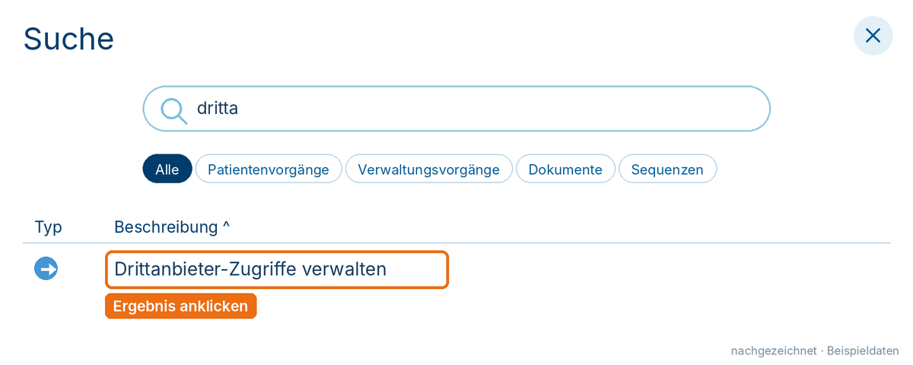
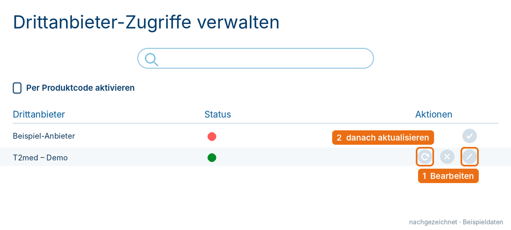
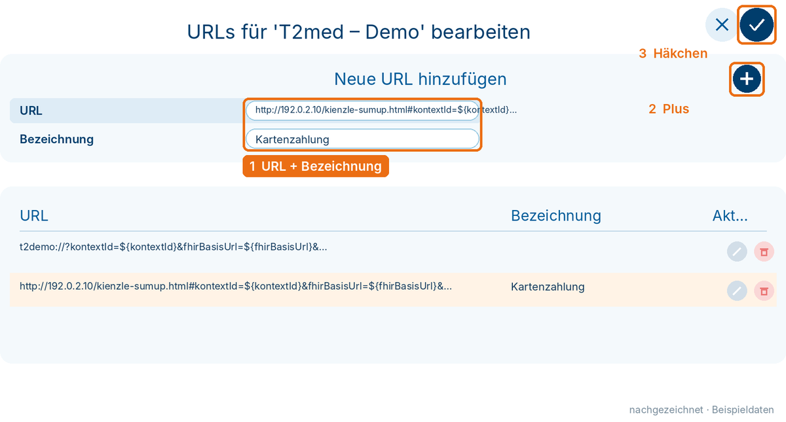
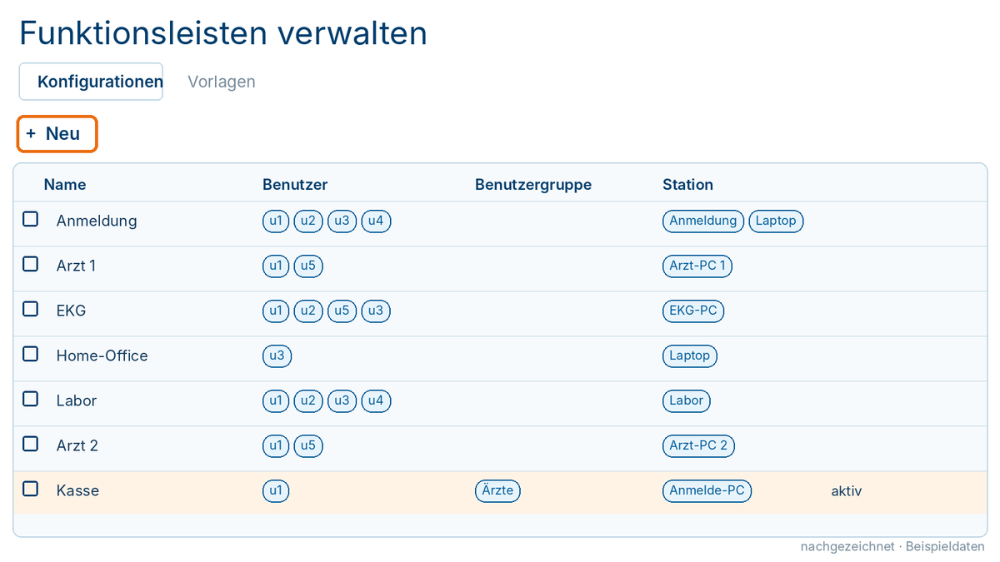
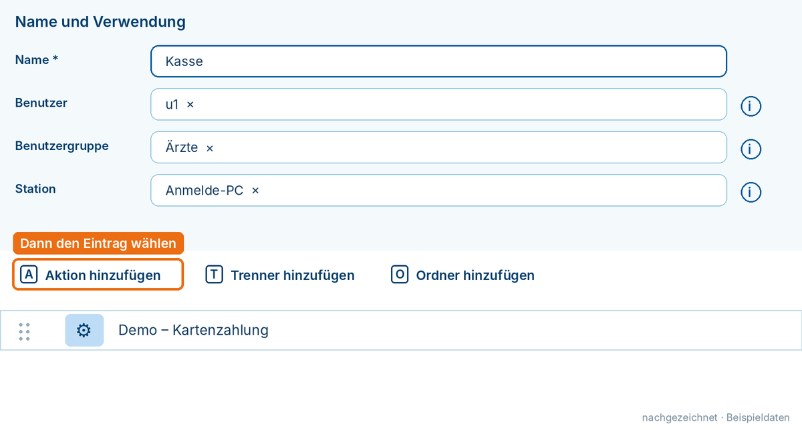
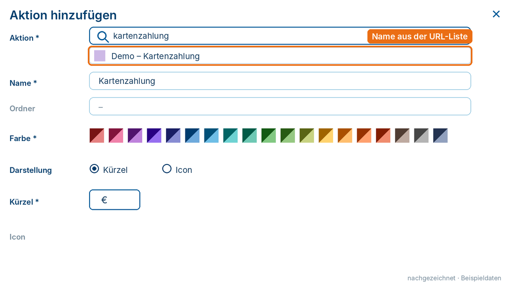

# T2med einrichten: Button „Kartenzahlung“ in der Funktionsleiste

Einmalige Einrichtung in T2med. Die Bilder sind nachgezeichnet, mit Beispieldaten und Platzhalter-Adresse.
Die Aufruf-Adresse steht im Adminpanel unter *Einrichtung → T2med-Anbindung* (zum Kopieren).

## 1. Drittanbieter-Zugriff anlegen

1. In T2med die Suche öffnen und **„Drittanbieter-Zugriffe verwalten“** eingeben, Ergebnis anklicken.
   Fehlt die Funktion, muss ein Administrator sie für den Benutzer erst freischalten.

   

2. In der Liste den Eintrag über den **Stift** bearbeiten.

   

3. Unter „Neue URL hinzufügen“ die **Adresse** der Kienzle-Suite und eine **Bezeichnung** (z. B. „Kartenzahlung“)
   eintragen, auf **Plus** klicken, dann oben rechts mit dem **Häkchen** speichern.
   Danach in der Liste davor die **Aktualisieren-Pfeile** anklicken.

   

## 2. Schaltfläche in der Funktionsleiste anlegen

4. **Funktionsleisten verwalten** öffnen, eine Konfiguration anlegen oder bearbeiten.

   

5. Name, Benutzer, Benutzergruppe und Station festlegen, dann **Aktion hinzufügen**.

   

6. Die Aktion über die vergebene **Bezeichnung** suchen, Farbe und Kürzel (oder Icon) wählen, bestätigen.

   

Jetzt erscheint die Schaltfläche beim Patienten. Ein Klick schickt die Patientendaten per FHIR an die Suite.

## 3. Drucker „SumUp-Rechnung“ und Terminzettel

- Rechnungen in T2med auf den Drucker **„SumUp-Rechnung“** drucken (Papier A4). Sie landen im Rechnungseingang.
- Für den Terminzettel in T2med unter *Einstellungen → Kalender → Terminliste (DIN A6)* den Drucker **„Terminzettel“** wählen.

Die Druckeradressen zeigt das Adminpanel unter *Einrichtung → Überblick*.
